# FibreX Monitor

A local-first macOS menu-bar app for watching an **MTN FibreX** internet connection.
It measures real connectivity, latency, and packet loss, records outages with
their recovery times, runs an honest speed test against a public endpoint, and
surfaces read-only Huawei OptiXstar router statistics — with no cloud service,
no account, and no changes to your router.

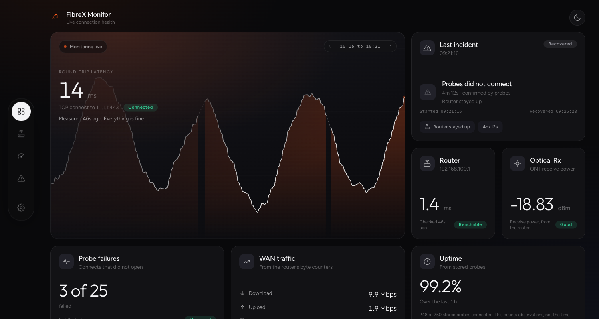

- **Honest by construction** — a `0` never stands in for "unavailable", status
  colours always come with words, and every figure on screen comes from a
  measurement the app actually made.
- **Local-first** — every probe, speed test, and incident lives in a local
  SQLite database on your Mac. Nothing is uploaded anywhere.
- **Router read-only** — the app logs into the router to read pages and never
  writes a single setting. Router reachability and internet reachability are
  kept strictly separate, so "the Wi-Fi is up" and "the internet is down" are
  never confused.

---

## Watch it

[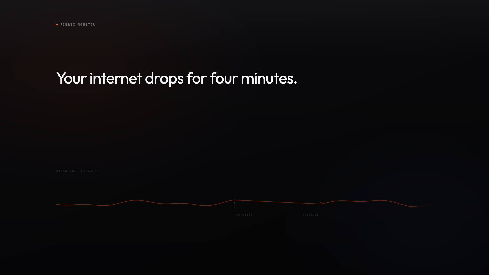](https://github.com/Nierowheezy/FibreX-Monitor/releases/download/v0.1.1/fibrex-monitor-launch.mp4)

100 seconds, every screen, and an honest answer to the question the app keeps
inviting: is this useful, or just fun for people who ping for sport? Both. The
useful half is the record — when the line drops for four minutes and comes back
before you can look, the app still has the failed probes, the start time, the
recovery time, and whether the router answered. That is the difference between
"it keeps dropping" and "4m 12s, router stayed up", and it is the sentence that
starts a better support conversation.

Music: Sascha Ende, [ende.app](https://ende.app/en) (CC BY 4.0).

The longer story — what it measures, the rules it refuses to break, and how the
video was made — is in [WRITEUP.md](WRITEUP.md).

---

## Download and install

Grab the latest `.zip` from the
[Releases page](https://github.com/Nierowheezy/FibreX-Monitor/releases):

1. Download the release `.zip` and unzip it.
2. Drag **FibreX Monitor.app** into `/Applications` (or run it from anywhere).
3. macOS Gatekeeper will warn on first launch because the bundle is unsigned —
   right-click the app and choose **Open**, then confirm **Open** again.
   This happens once; after that it opens like any other app.
4. The FibreX mark appears in your menu bar. Click the icon for the live panel,
   which opens the dashboard window.

> Why the warning? The bundle is not signed with an Apple Developer identity
> and has not been notarized. That is a packaging step, not a content problem —
> anyone can verify the source here and build it themselves with
> `npm run tauri build`.

## Getting set up — three steps

1. **Install and open it.** Without any configuration the app already works:
   it probes your connection every few seconds and records outages and
   incidents. There is nothing else required to get value from it.
2. **Connect the router cards.** Open **Settings → Router connection**, fill in
   your router's address, port, user name, and password (the same ones you type
   into `192.168.100.1` in a browser), and press **Save connection**. The
   password is stored in your macOS Keychain — not in a file. Within half a
   minute the router sections start filling in: WAN traffic, link state,
   uptime, firmware details.
3. **Leave it running.** Each outage is written to the incident timeline with
   its exact start, end, and duration — evidence you can show an ISP support
   conversation instead of describing it from memory.

## Using each screen

| Screen | What it is |
|---|---|
| **Overview** | Live connection health at a glance: current state, recent incidents, today's traffic, the router snapshot. |
| **Fibre and Router** | The fibre line and the router on it: link status, uptime, WAN traffic, firmware details pulled live from the OptiXstar router. |
| **Speed test** | Runs a real measurement in three named phases — **Ping**, **Download**, **Upload** — each phase labelled on the gauge while it measures, against `speed.cloudflare.com`. |
| **Incidents** | The exact record: when the line went down, when it recovered, how long it took. Newest first, in a fixed-height scroll list. |
| **Settings** | Pause the monitoring, choose light/dark appearance, and edit the router connection. |

### Settings → Router connection, in detail

Every field is editable in the app; nothing has to be typed anywhere else.

| Field | What to enter |
|---|---|
| **Address** | Your router's LAN address. MTN FibreX routers usually answer on `192.168.100.1`. |
| **Port** | The router's web UI port — `80` is the firmware default (it serves HTTP, not HTTPS). |
| **User name** | The same admin user name you use to log into the router in a browser. |
| **Password** | The router's admin password. It is stored in the **macOS Keychain** and never shown again or written to any file — the field is empty with a *"Stored — type a new one to replace it"* note when one is held. |

Two extra details worth knowing:

- **Saving without typing a password keeps the stored one.** Change the
  address freely without having to retype the password every time.
- **Saving is arming, not instant.** The reader runs on a slow, deliberate
  cadence (about half a minute) to be kind to the router's small web server;
  the badge turns to **Reading** once a read is under way.
- **Removing** the connection (a two-click confirm) erases the stored settings
  and the Keychain password and the router sections go quiet.

> Developer note: the `FIBREX_ROUTER_HOST` / `FIBREX_ROUTER_PORT` /
> `FIBREX_ROUTER_USERNAME` / `FIBREX_ROUTER_PASSWORD` environment variables
> still work and take precedence over the stored settings while present — see
> [.env.example](.env.example). They exist for shell-driven testing; the
> Settings card is the way everyone else should configure the app.

### Screenshots

Dark is the default theme; light is a full inversion, not a recolour.

| Screen | Dark | Light |
|---|---|---|
| **Overview** |  | 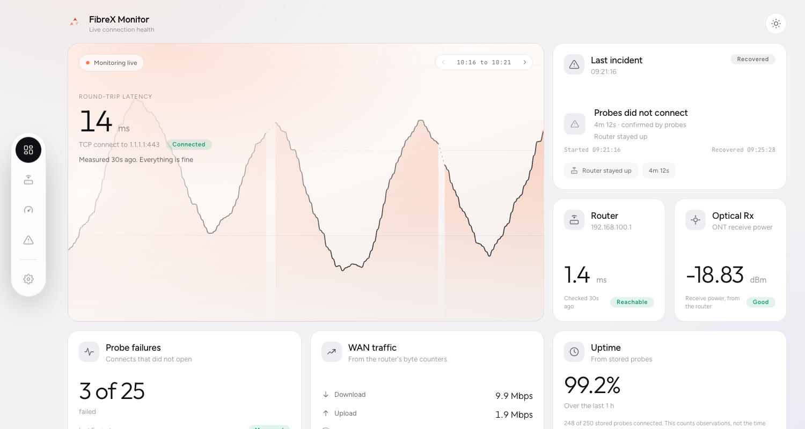 |
| **Fibre and Router** | 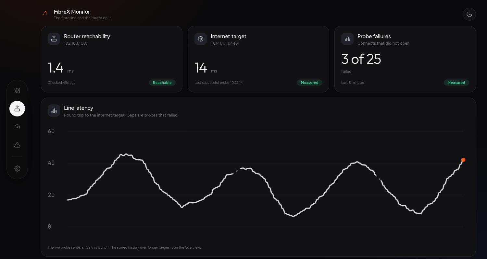 | 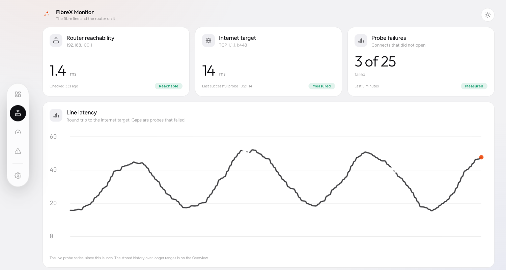 |
| **Speed test** | 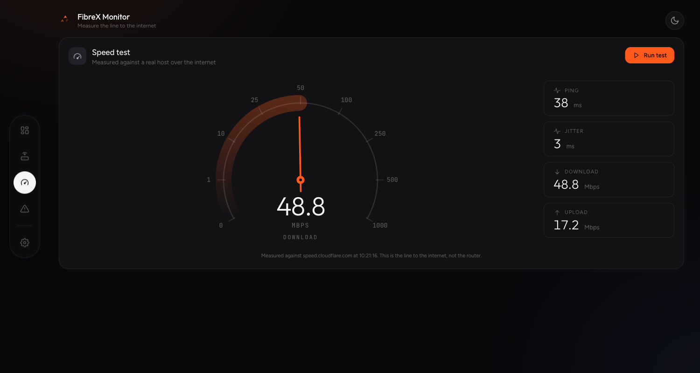 | 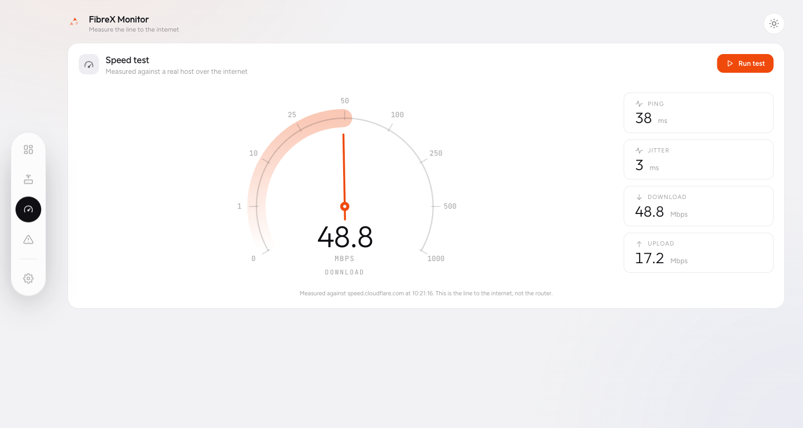 |
| **Incidents** | 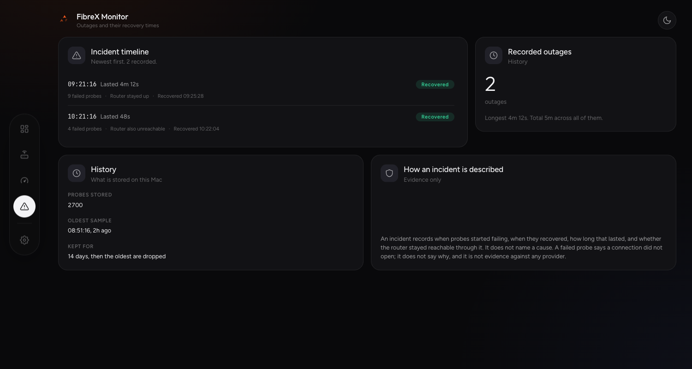 | 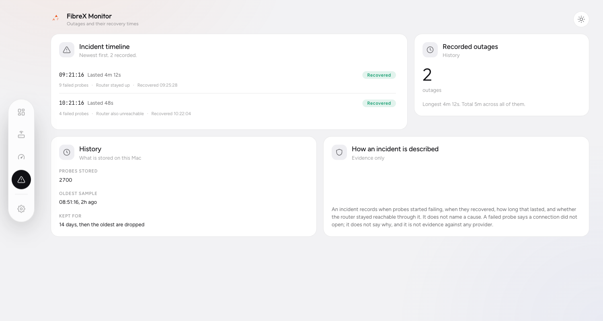 |
| **Settings** | 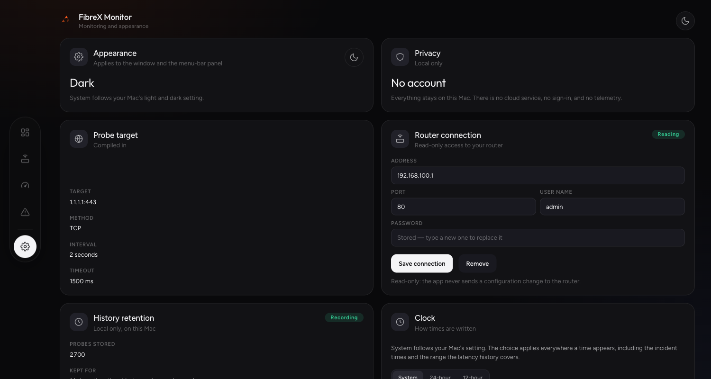 | 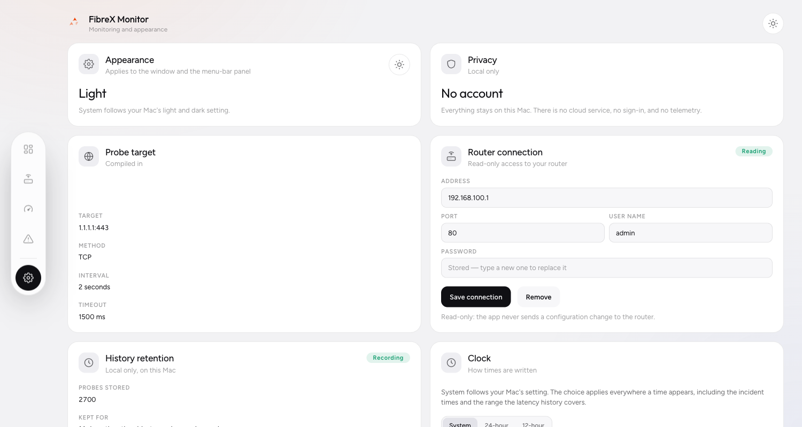 |

### Honest limitations

Things the app cannot do, stated up front so expectations are set:

| What you might expect | Why it isn't there |
|---|---|
| A "Devices" page | The onboard firmware answers `"NONE"` for the device-list endpoint — no list can be built from nothing. A screen that cannot be filled was removed rather than left apologising. |
| Optical transmit figures | The firmware reports receive power only — transmit power, temperature, voltage and bias current are not exposed at all, so no field exists for them. |
| A WAN traffic number that matches a speed test exactly | They measure different things: the router card reports what **all devices are transferring** on the WAN at that moment, while the speed test is **one synthetic burst** from one device. Both are shown in Mbps, and both are correct for their own question. |
| Automatic update | The app is built and released by hand; check the Releases page. |
| Notarised install | Would need an Apple Developer signing identity. |
| Blaming the ISP | Never shown without real evidence of where the failure happened. The app keeps router reachability and internet reachability separate for exactly this reason, and the incident log tells you which one broke. |

## Development

```bash
# 1. Install dependencies
npm install

# 2. Frontend only (browser, no Rust) — quick iteration
npm run dev

# 3. Full desktop app in dev mode (needs Rust and Cargo installed)
npm run tauri dev

# 4. Build the unsigned .app bundle for distribution
npm run tauri build
```

### Verification

| Command | What it runs |
|---|---|
| `npm run verify` | TypeScript typecheck (tsc) + Vitest unit tests |
| `npm test` | Vitest unit tests |
| `npm run build` | Typecheck + Vite production bundle |
| `cargo test` | Unit tests for the measurement engine and the settings logic |
| `cargo check` | Fast check that the Rust compiles |
| `cargo clippy` | Linting (clean, no warnings) |

### The browser harness

`npm run harness` serves the built frontend on <http://localhost:4173> with a
stub that answers all Tauri commands with realistic figures, so the interface
can be inspected in a regular browser. It also mirrors the Tauri v2 event API,
so running states (gauge sweep, phase captions) can be captured with virtual
time:

```bash
npm run build
npm run harness &
open 'http://localhost:4173/?click=Speed%20test&run=1'
```

Query flags: `?click=<screen name>` switches screen, `?run=1` presses the
test's Run button, `?width=340` narrows the page to a width, `?clock=12` sets
12-hour time, `?theme=light` or `?theme=dark` pins the appearance.

## Privacy and security

- No telemetry, no analytics, no network calls other than (a) probe requests to
  the internet you are monitoring, (b) an optional speed test against
  `speed.cloudflare.com`, whose name is shown on screen while it runs, and
  (c) the read-only page fetches to your own router when configured.
- Where things stay: probe records, incident timelines, and speed test history
  live in a local SQLite database on this Mac; the router address, port, and
  user name live in a JSON file in the app's settings directory; the password
  lives only in the macOS Keychain. Nothing leaves the machine unless the
  speed test is running or a router read is in progress.
- Router integration is read-only by design. The app sends only a sign-in and
  page reads; it does not and will not modify your router.

## License

MIT — see [LICENSE](LICENSE).

## Changelog

- **v0.1.1** — the menu-bar panel now opens over whatever app and desktop Space is in front, dismisses when you click in another app, and wears the app's own ember mark in the menu bar instead of a placeholder signal icon.
- **v0.1.0** — the first release on GitHub. FibreX monitoring with an incident timeline, an honest speed test, read-only Huawei OptiXstar router statistics, and the router connection configured in-app under Settings with the password in the Keychain. Full history in [CHANGELOG.md](CHANGELOG.md).
